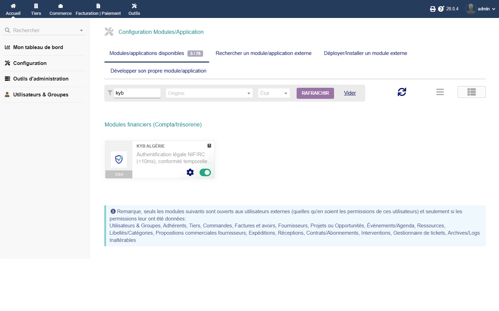
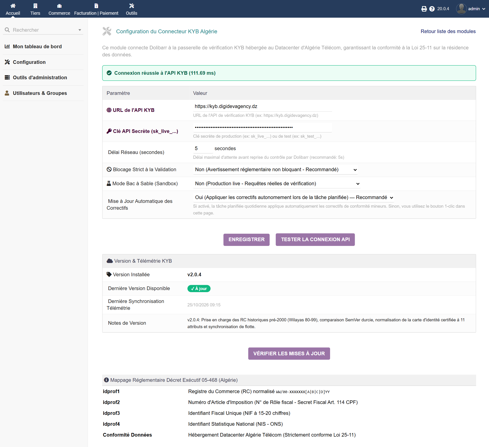
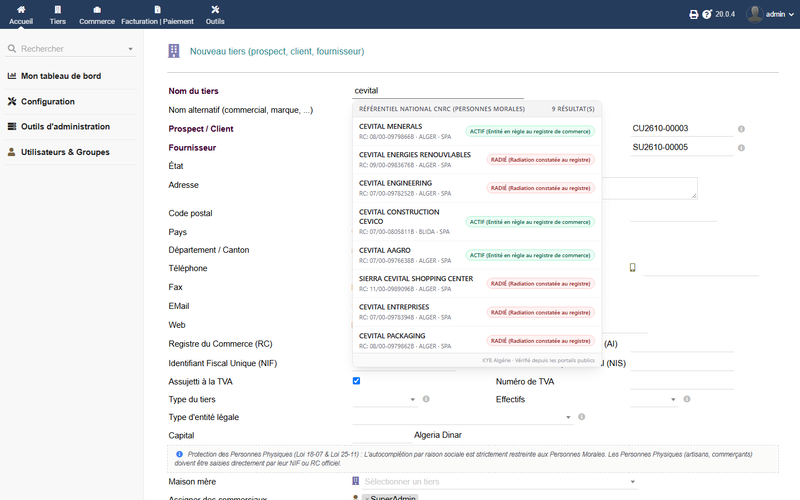
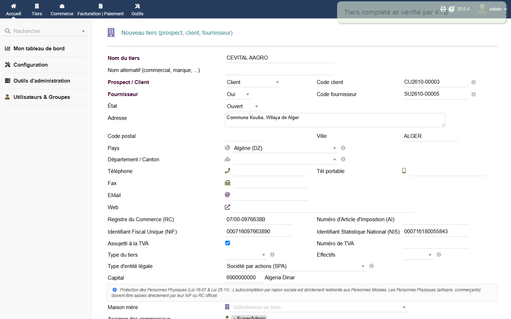
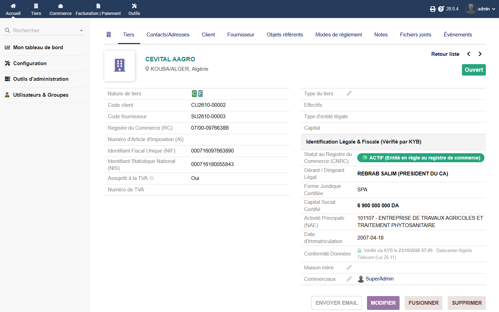
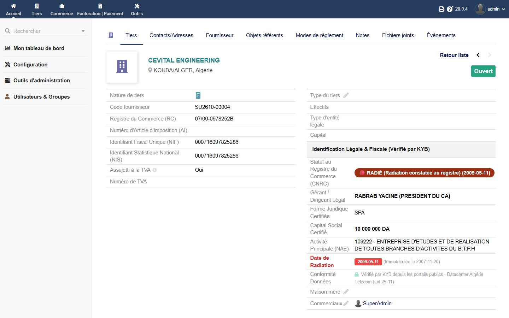
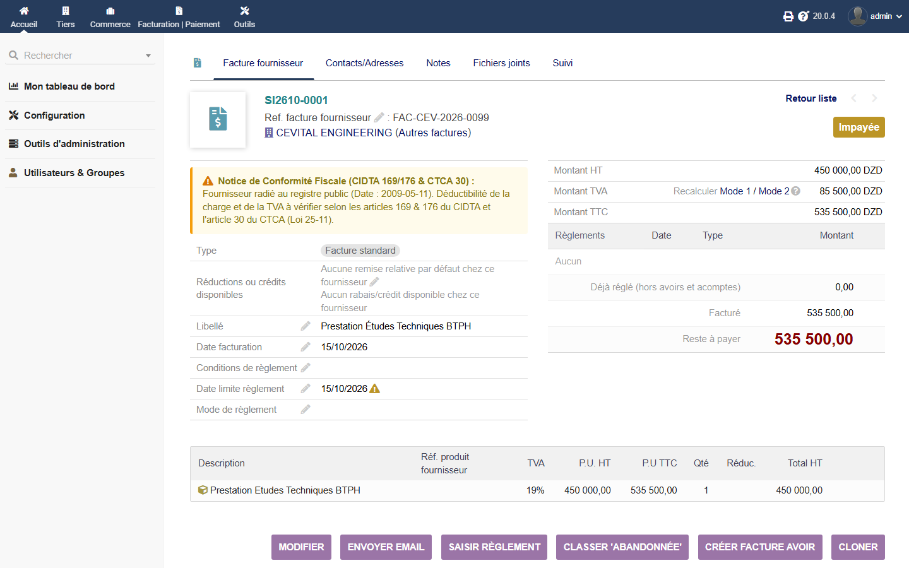

# KYB pour Dolibarr — Manuel Utilisateur & Guide Pratique d'Intégration
**Version :** `2.0.4`  
**Cible :** Directeurs Financiers (DAF), Responsables Comptables, Gestionnaires des Achats et Ventes, Administrateurs ERP  
**Portail KYB (by Digidev Agency) :** [kyb.digidevagency.dz](https://kyb.digidevagency.dz)  
**Compatibilité :** Dolibarr 19.0 LTS, 20.0, 21.0, 22.0 (Community & Enterprise — PHP 8.0 à 8.3)  
**Datacenter Souverain :** Algérie Télécom, Alger (Conformité Loi 25-11)

---

## Sommaire Exécutif

* [1. À propos du module KYB pour Dolibarr](#1-à-propos-du-module-kyb-pour-dolibarr)
* [2. Installation & Déploiement du Connecteur](#2-installation--déploiement-du-connecteur)
* [3. Configuration & Politiques de Gouvernance](#3-configuration--politiques-de-gouvernance)
* [4. Saisie Intelligente & Autocomplétion par Raison Sociale](#4-saisie-intelligente--autocomplétion-par-raison-sociale)
* [5. Renseignement Automatique des Identifiants (Décret 05-468)](#5-renseignement-automatique-des-identifiants-décret-05-468)
* [6. Consultation des Fiches Tiers & Conformité Légale](#6-consultation-des-fiches-tiers--conformité-légale)
* [7. Contrôle Temporel des Factures Fournisseurs](#7-contrôle-temporel-des-factures-fournisseurs)
* [8. Audit Fiscal de Masse (État 104) & Mode Sandbox](#8-audit-fiscal-de-masse-état-104--mode-sandbox)
* [9. Questions Fréquentes (FAQ)](#9-questions-fréquentes-faq)
* [10. Support Technique & Contacts Institutionnels](#10-support-technique--contacts-institutionnels)

---

## 1. À propos du module KYB pour Dolibarr

Le module **KYB pour Dolibarr** connecte votre ERP à la passerelle de vérification KYB opérée au sein du Datacenter d'Algérie Télécom à Alger. Il accompagne les directions financières et les services comptables dans l'automatisation de l'identification des tiers et la sécurisation fiscale de leurs opérations :

* **Auto-complétion Instantanée des Tiers (<150ms) :**  
  La saisie du **NIF (15 chiffres)**, du **Registre de Commerce (RC)** ou de la **Raison Sociale** dans la fiche tiers renseigne automatiquement l'ensemble des mentions légales : Raison sociale, Sigle commercial, RC normalisé, Article d'imposition, NIF, NIS et Adresse du siège social.
* **Mappage Réglementaire Décret 05-468 :**  
  Exploitation native des identifiants professionnels Dolibarr dédiés à l'Algérie (`idprof1` à `idprof4`) sans altération de la base de données standard.
* **Audit Temporel des Factures Fournisseurs :**  
  Contrôle automatique de l'activité du fournisseur à la **date d'émission de la facture**. Alerte la comptabilité ou bloque la validation si le fournisseur est répertorié radié au Registre du Commerce, contribuant à la protection de la déductibilité des charges (CIDTA 169 & 176) et de la TVA (CTCA 30).
* **Architecture Thin Model/Record (Thin MR) :**  
  Aucune règle métier lourde n'est exécutée en local. L'ensemble de la logique fiscale et de la normalisation est pris en charge par le moteur de vérification KYB.
* **Résidence des Données & Loi 25-11 :**  
  100% des flux d'identification et de conformité sont traités et conservés sur le territoire algérien, sans recours à des API ou des CDN étrangers.

---

## 2. Installation & Déploiement du Connecteur

Le déploiement du module s'effectue en quelques étapes simples dans votre instance Dolibarr.

### Étape 1 : Déploiement de l'Archive
1. Téléchargez l'archive officielle `module_kybdolibarr-2.0.4.zip` depuis votre espace client ou portail d'onboarding.
2. Connectez-vous en tant qu'administrateur dans Dolibarr.
3. Rendez-vous dans **Accueil → Configuration → Modules/Applications → Déployer un module externe**.
4. Téléversez le fichier ZIP. Dolibarr installe automatiquement le module dans le répertoire `custom/kybdolibarr`.
*(Alternative pour les serveurs Linux : décompressez l'archive dans le dossier `/var/www/html/custom/kybdolibarr` et attribuez les droits `www-data:www-data`).*

### Étape 2 : Activation du Module
1. Rendez-vous dans **Accueil → Configuration → Modules/Applications disponibles**.
2. Recherchez `KYB` ou naviguez jusqu'au groupe **Gestion financière**.
3. Activez le module **KYB Algérie** en basculant l'interrupteur sur **ON**.

*Figure 1 : Interface d'activation du module KYB Algérie dans la liste des applications Dolibarr.*

---

## 3. Configuration & Politiques de Gouvernance

L'accès aux paramètres s'effectue en cliquant sur l'icône d'engrenage à droite du module activé, ou via l'URL `/custom/kybdolibarr/admin/setup.php`.

### Étape 1 : Renseignement des Accès API
* **URL de l'API KYB :** Conservez l'URL par défaut :  
  `https://kyb.digidevagency.dz`
* **Clé API Secrète :** Collez votre clé de production (`sk_live_...`) ou votre clé de test (`sk_test_...`). Dans l'interface, la clé est masquée (`••••••••••••••••••••••••`) pour préserver la confidentialité lors des partages d'écran.
* **Délai Réseau (Timeout) :** Fixé par défaut à `5` secondes (plage acceptée : 2 à 15 secondes). En cas de ralentissement réseau, Dolibarr reprend la main sans interrompre le travail de l'utilisateur.

*Figure 2 : Écran de configuration v2.0.4 affichant l'URL de l'API KYB, la clé API masquée, la mesure de latence en temps réel et le guide de correspondance Décret 05-468.*

### Étape 2 : Sélection de la Politique de Validation des Factures

Le module s'adapte à la politique de gestion des risques de votre direction financière :

| Paramètre | Option | Effet Métier dans Dolibarr |
| :--- | :--- | :--- |
| **Blocage Strict à la Validation** | **Non (Mode Avertissement)** | Une notice explicite s'affiche lors de la validation d'une facture d'un fournisseur radié, rappelant la date de radiation et les articles 169 & 176 du CIDTA. La validation reste possible pour les situations d'exception (ex: liquidation de litige). |
| **Blocage Strict à la Validation** | **Oui (Mode Bloquant)** | La validation comptable est techniquement interrompue si le fournisseur était radié à la date de facturation. La facture reste en brouillon (`fk_statut = 0`). |

### Étape 3 : Vérification de la Latence Réseau
Cliquez sur le bouton **Tester la Connexion API**. Une requête de diagnostic horodatée est transmise à la passerelle KYB, affichant en temps réel la latence réseau (généralement < 15ms sur le réseau national vers le Datacenter d'Algérie Télécom).

---

## 4. Saisie Intelligente & Autocomplétion par Raison Sociale

Lors de la création d'un tiers (**Tiers → Nouveau tiers**) :

### Étape 1 : Saisie de la Raison Sociale
Tapez au moins 3 caractères dans le champ **Nom du tiers**. Après 250ms de frappe, un menu déroulant interactif flottant affiche jusqu'à 10 propositions issues du référentiel CNRC avec les badges de statut réglementaire (ACTIF ou RADIÉ).

*Figure 3 : Menu déroulant interactif d'autocomplétion par raison sociale affichant les propositions officielles avec statuts ACTIF et RADIÉ.*

> [!NOTE]
> **Protection des Personnes Physiques (Loi 18-07 & Loi 25-11) :**  
> *L'autocomplétion par dénomination textuelle est strictement réservée aux Personnes Morales (entreprises enregistrées au CNRC). Les Personnes Physiques (artisans et commerçants individuels) sont légalement protégées contre la recherche nominative libre en vertu des lois algériennes sur la vie privée et la souveraineté des données. Elles doivent être enregistrées directement via leur NIF ou RC officiel.*

---

## 5. Renseignement Automatique des Identifiants (Décret 05-468)

Dès qu'une entreprise est sélectionnée ou qu'un NIF/RC est saisi :

### Étape 2 : Auto-remplissage Immédiat (Exemple Réel : CEVITAL AAGRO)
En moins de 150 millisecondes, le module peuple automatiquement l'ensemble des mentions réglementaires vérifiées :
* **Nom du Tiers (Raison Sociale) :** `CEVITAL AAGRO`
* **Registre du Commerce (RC) :** `07/00-0976638B` (Format normalisé Décret Exécutif n° 05-468).
* **Numéro d'Article d'Imposition (AI) :** Préservé vierge à la création (Secret Fiscal protégé par l'Article 114 du CPF).
* **Identifiant Fiscal Unique (NIF) :** `000716097663890` (Identifiant Unique National à 15 chiffres).
* **Identifiant Statistique National (NIS) :** `000716180055843` (Identifiant National ONS).
* **Capital Social :** `6900000000 Algeria Dinar` (Peuplé directement dans le champ `capital` Dolibarr).
* **Forme Juridique :** `Société par actions (SPA)` (Sélectionnée automatiquement dans le menu déroulant).
* **Activité Principale NAE :** `101107` (Code d'activité économique renseigné dans le champ `ape`).
* **Adresse & Ville :** `KOUBA/ALGER`, Wilaya d'Alger.

*Figure 4 : Formulaire tiers complété et vérifié par KYB après sélection de CEVITAL AAGRO (RC, NIF, NIS, Capital, Ville).*

---

## 6. Consultation des Fiches Tiers & Conformité Légale

Chaque fiche tiers affichée dans Dolibarr (**Tiers → Liste des tiers → Fiche Tiers**) est enrichie en temps réel par les données du bloc **Identification Légale & Fiscale (Vérifié par KYB)** :

1. **Volet Gauche — Identifiants Réglementaires (Décret 05-468) :**
   * **Registre du Commerce (RC) :** Numéro vérifié normalisé (`idprof1`).
   * **Numéro d'Article d'Imposition (AI) :** Rôle fiscal crowd-caché ou protégé (`idprof2`).
   * **Identifiant Fiscal Unique (NIF) :** NIF validé à 15 chiffres (`idprof3`).
   * **Identifiant Statistique National (NIS) :** Numéro statistique ONS (`idprof4`).
2. **Volet Droit — Bloc d'Identification Légale & Fiscale (Vérifié par KYB) :**
   * **Statut au Registre du Commerce (CNRC) :** Badge de statut officiel horodaté.
   * **Gérant / Dirigeant Légal :** Représentant légal extrait des actes officiels publiés.
   * **Forme Juridique Certifiée :** Forme sociétaire (`SPA`).
   * **Capital Social Certifié :** Montant du capital social libéré (chiffres tabulaires).
   * **Activité Principale (NAE) :** Code et libellé officiel de la nomenclature d'activités.
   * **Date d'Immatriculation / Radiation :** Historique temporel officiel CNRC.
   * **Conformité Données :** `🔒 Vérifié via KYB · Datacenter Algérie Télécom (Loi 25-11)`. Horodatage certifié de l'interrogation officielle au registre pour traçabilité d'audit comptable.

### Cas 1 : Entité Active et Conforme (Exemple Réel : CEVITAL AAGRO)
* **Statut CNRC :** `🟢 ACTIF (Entité en règle au registre de commerce)`
* **Gérant / Dirigeant Légal :** `REBRAB SALIM (PRESIDENT DU CA)`
* **Forme Juridique :** `SPA`
* **Capital Social Certifié :** `6 900 000 000 DA`
* **Activité Principale (NAE) :** `101107 - ENTREPRISE DE TRAVAUX AGRICOLES ET TRAITEMENT PHYTOSANITAIRE`
* **Date d'Immatriculation :** `2007-04-18`

*Figure 5 : Fiche tiers de CEVITAL AAGRO présentant le bloc complet d'identification légale et fiscale vérifié par KYB.*

### Cas 2 : Fournisseur Radié du Registre (Exemple Réel : CEVITAL ENGINEERING)
* **Statut CNRC :** `🔴 RADIÉ (Radiation constatée au registre) (2009-05-11)`
* **Gérant / Dirigeant Légal :** `RABRAB YACINE (PRESIDENT DU CA)`
* **Forme Juridique :** `SPA`
* **Capital Social Certifié :** `10 000 000 DA`
* **Activité Principale (NAE) :** `109222 - ENTREPRISE D'ETUDES ET DE REALISATION DE TOUTES BRANCHES D'ACTIVITES DU B.T.P.H`
* **Date de Radiation :** `2009-05-11 (Immatriculée le 2007-11-20)`

*Figure 6 : Fiche du fournisseur CEVITAL ENGINEERING affichant l'alerte d'entreprise radiée avec mention expresse de la date de radiation.*

---

## 7. Contrôle Temporel des Factures Fournisseurs

Conformément aux dispositions des **Articles 169 & 176 du Code des Impôts Directs (CIDTA)** et de l'**Article 30 du Code des Taxes sur le Chiffre d'Affaires (CTCA)**, les achats effectués auprès d'opérateurs radiés ne sont fiscalement déductibles ni au titre des charges d'exploitation (IBS/IRG), ni au titre de la récupération de la TVA.

### Déroulement du Contrôle & Détection d'Anomalie
1. Votre équipe comptable consulte ou enregistre une facture fournisseur (**Facturation | Paiement → Factures fournisseurs**).
2. Dans le cas d'une facture émise par un fournisseur radié (ex: facture `SI2610-0001` de `CEVITAL ENGINEERING` datée du `15/10/2026`, postérieure à sa radiation du `11/05/2009`) :
   * **En mode Avertissement (Recommandé) :** Une bannière d'alerte réglementaire ambrée s'affiche en en-tête de la pièce comptable :  
     `⚠️ Notice de Conformité Fiscale (CIDTA 169/176 & CTCA 30) : Fournisseur radié au registre public (Date : 2009-05-11). Déductibilité de la charge et de la TVA à vérifier selon les articles 169 & 176 du CIDTA et l'article 30 du CTCA (Loi 25-11).`
   * **En mode Blocage Strict :** La validation comptable est techniquement interrompue et la pièce reste consignée au statut brouillon (`fk_statut = 0`).

*Figure 7 : Facture fournisseur affichant la bannière réglementaire de conformité temporelle suite à la détection d'un fournisseur radié.*

---

## 8. Audit Fiscal de Masse (État 104) & Mode Sandbox

### Audit Fiscal de Masse de vos Partenaires
Dans la liste des tiers (**Tiers → Liste des tiers**), cochez l'ensemble de vos fournisseurs actifs ou filtrez par catégorie d'achats. Dans le sélecteur d'actions groupées (*Action de masse*), choisissez **Audit Fiscal KYB (Loi 25-11 / État 104)**.  
Le moteur interroge la passerelle et met à jour en arrière-plan le statut légal, les dates de radiation éventuelles et les coordonnées de chaque entreprise. Les comptes présentant des risques fiscaux sont automatiquement isolés pour assainissement avant l'arrêté des comptes et le dépôt de l'annexe fiscale État 104.

### Mode Sandbox Déterministe (Magic NIFs)
Pour vos sessions de formation interne, de recette ou de démonstration, le connecteur reconnaît des identifiants déterministes (Magic NIFs) sans décompte de crédits :
* `000016001234567` : Entité active standard (ACTIF).
* `000016007654321` : Entité radiée (RADIÉ - Date : 2021-06-15).
* `000000000000404` : Entité introuvable dans le référentiel national.

### Traçabilité d'Audit & Journalisation des Requêtes (Loi 25-11)
Chaque interrogation officielle effectuée par le module est automatiquement consignée dans Dolibarr avec les métadonnées de certification pour servir de preuve probante lors des contrôles fiscaux :
* **Horodatage Officiel :** Date et heure de consultation à la seconde près.
* **Signature Datacenter :** Nœud souverain Algérie Télécom (Loi 25-11).
* **Empreinte de Vérification :** Horodatage certifié affiché sur la fiche tiers pour opposabilité fiscale.

---

## 9. Questions Fréquentes (FAQ)

### Utilisation & Gestion au Quotidien

**Que faire lorsqu'une société n'apparaît pas dans l'auto-complétion ?**  
Si une entreprise est de création très récente, s'il s'agit d'une dénomination commerciale abrégée ou en cas de variante orthographique, saisissez directement son **NIF à 15 chiffres** ou son **Numéro RC** dans les champs correspondants du formulaire Dolibarr. Le connecteur interrogera directement le registre central sur ces identifiants officiels uniques et peuplera instantanément la fiche.

**Comment identifier un commerçant individuel ou un artisan (Personne Physique) ?**  
Conformément à la Loi 18-07 sur la protection des données personnelles et à la Loi 25-11 sur la souveraineté numérique, la recherche nominative prédictive est strictement réservée aux Personnes Morales. Pour un commerçant individuel ou un artisan, effectuez l'identification par son **NIF individuel à 15 chiffres** (commençant par `1`) ou son **Numéro RC Catégorie A ou C** (ex : `16/00-0123456A20`).

**Pourquoi le numéro d'Article d'Imposition (Rôle) n'est-il pas rempli automatiquement ?**  
En vertu de l'**Article 114 du Code des Procédures Fiscales (CPF)**, le Numéro d'Article d'Imposition relève du secret fiscal et n'est pas un identifiant public. Il figure obligatoirement sur les factures papier imprimées de vos fournisseurs (Décret 05-468). Il vous suffit de le renseigner une seule fois lors du premier traitement de facture : KYB le conserve et l'associe définitivement à la fiche tiers (`idprof2`) pour vos futures déclarations.

**Que faire si une facture affiche l'alerte « Notice de Conformité Fiscale (CIDTA 169/176 & CTCA 30) : Fournisseur radié » ?**  
Cette notice signale que le fournisseur était officiellement radié du registre public (CNRC) à la date d'émission de la facture. En droit fiscal algérien (Articles 169 & 176 CIDTA et Art. 30 CTCA), les charges et la TVA d'un fournisseur radié ne sont pas déductibles. Rapprochez-vous de votre fournisseur pour obtenir une attestation de régularité fiscale récente ou faites valider la pièce par votre direction financière (DAF) selon la politique interne de votre entreprise.

**Comment traiter un doublon fiscal détecté lors de la création d'un tiers ?**  
Lorsque le système signale qu'un NIF ou un RC existe déjà dans votre base Dolibarr, annulez la création pour utiliser la fiche déjà présente. Si deux fiches ont été créées par inadvertance, utilisez l'outil natif de Dolibarr (**Tiers → Outils → Fusionner des tiers**) : l'historique comptable, les factures et l'ensemble des données certifiées KYB sont intégralement conservés sur la fiche consolidée.

**L'auto-complétion prédictive consomme-t-elle des crédits ?**  
Non. La recherche prédictive par nom et l'affichage des suggestions dans le menu déroulant avec statuts légaux sont inclus à **0 crédit** (recherches illimitées). Seul l'enrichissement certifié d'une fiche (sélection d'une entité ou recherche par NIF/RC pour importer ses attributs légaux complets) déduit 1 crédit de votre solde.

**Que se passe-t-il si un enrichissement officiel ne renvoie aucun résultat ?**  
Le système applique la règle stricte du remboursement automatique (*Zero Freebies / Auto-Refund*) : si une entité recherchée par NIF ou RC est introuvable ou si le portail officiel rencontre une indisponibilité momentanée, le crédit prélevé est automatiquement et immédiatement récrédité sur votre compte sans aucune démarche requise.

### Configuration & Administration

**Comment tester le connecteur gratuitement (Mode Sandbox) ?**  
Vous pouvez utiliser la clé d'essai gratuite `sk_test_kyb_sandbox_key_001` ou vos clés de production avec les NIFs déterministes réservés au bac à sable commençant par `0000...` (ex : `000016001234567` pour une société active, `000016007654321` pour une société radiée). Ces requêtes de test ne consomment aucun crédit.

**Comment renouveler ou modifier ma clé d'API KYB ?**  
Connectez-vous sur [kyb.digidevagency.dz](https://kyb.digidevagency.dz) dans la rubrique **Clés API & Intégrations** et générez une nouvelle clé. Dans Dolibarr, accédez à **Accueil → Configuration → Modules/Applications → KYB Algérie (Configuration)**, collez la nouvelle clé dans le champ **Clé API Secrète**, puis cliquez sur **Enregistrer**.

**Comment mettre à jour le connecteur KYB vers une nouvelle version ?**  
Téléchargez la nouvelle archive `module_kybdolibarr-x.y.z.zip` et déposez-la via **Déployer un module externe** (ou remplacez les fichiers dans `custom/kybdolibarr`). Rendez-vous ensuite sur la page de configuration du module pour vérifier que la nouvelle version est active.  
> [!CAUTION]
> **Ne jamais désinstaller ou supprimer le module.** La désinstallation d'un module peut altérer les tables associées. Pour mettre à jour, appliquez simplement la nouvelle archive par-dessus l'existante.

---

## 10. Support Technique & Contacts Institutionnels

Développé et certifié par **Digidev Agency** :
* **Portail KYB :** [https://kyb.digidevagency.dz](https://kyb.digidevagency.dz)
* **Documentation & API :** [https://kyb.digidevagency.dz/docs](https://kyb.digidevagency.dz/docs)
* **Assistance DAF & IT :** `contact@digidevagency.dz` &bull; Réponse garantie sous 4 heures ouvrées
* **Support Client :** `support@kyb.digidevagency.dz`
* **Dépôt GitHub Public :** [https://github.com/mouadh25/kyb-dolibarr](https://github.com/mouadh25/kyb-dolibarr) (Licence GPL-3.0+)
